## The question

A complete **exploratory data analysis** of an extensive online-retail dataset, carried through to **classification and time-series forecasting**. The goal is insight for the business teams responsible for decisions, with techniques that apply to any marketing dataset.

## The chapters

1. Sales and revenue analysis
2. Customer segmentation
3. Cross-country analysis
4. Forecasting

## Methods

- Interactive dashboards
- **Dask** for larger-than-comfortable data
- Classification with **extreme gradient boosting** (XGBoost)
- Forecasting with **Prophet**

## Figures

<table>
<tr><td width="100%" valign="top"> Actual vs predicted total price over two years</td></tr>
<tr><td width="100%" valign="top"> Forecast with its uncertainty interval</td></tr>
<tr><td width="100%" valign="top"> Total price, year against year</td></tr>
</table>

## Run it

1. Download `requirements.txt`.
2. Follow the instructions in [`Conda_Virtual_Env.txt`](Conda_Virtual_Env.txt).

`requirements.txt` is a full freeze of the original environment, and some entries point to local conda builds. If pip cannot resolve them, install the packages listed under *Built with* below.

Then open [`online_retail.ipynb`](online_retail.ipynb).

## Built with

`Python` · `NumPy` · `pandas` · `Matplotlib` · `Seaborn` · `Plotly` · `scikit-learn` · `Dask` · `Joblib` · `XGBoost` · `itertools` · `Prophet`

 

<a href="https://github.com/johnnyk1090">← back to the profile</a>

